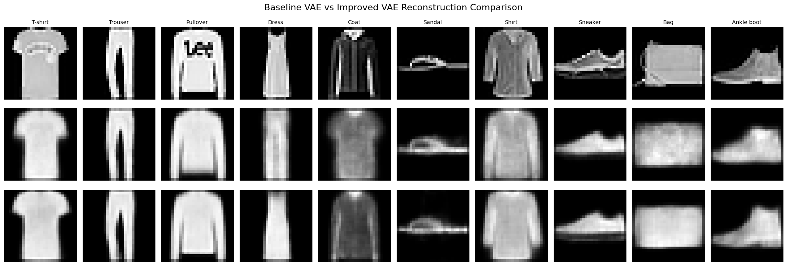
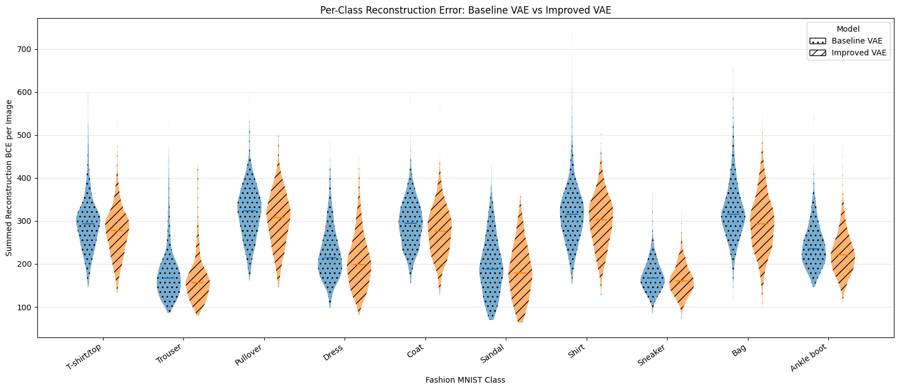
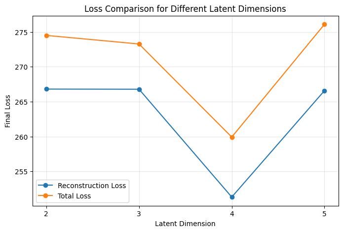
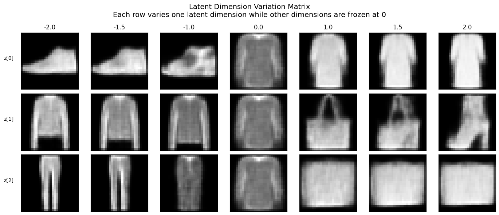
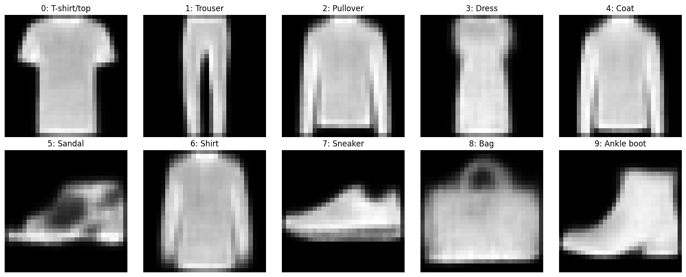
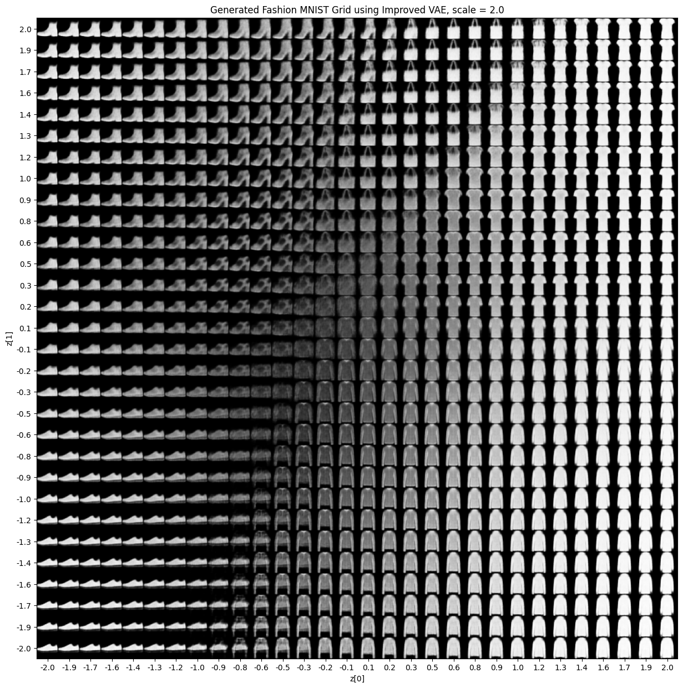

# Fashion-MNIST Variational Autoencoder | Latent Space & Reconstruction Experiments

   

**Can a small variational autoencoder learn to reconstruct and generate recognisable clothing images?** This project investigates how latent dimensionality, model architecture, and KL regularisation affect the learned representations of Fashion-MNIST's 10 clothing categories.

Developed as an individual deep-learning laboratory investigation, the portfolio includes **five connected VAE experiments**, an improved 3-dimensional VAE, and a comparison with a deterministic autoencoder.

> **Scope:** This repository covers **Fashion-MNIST VAE work**, not the separate MNIST/DCGAN experiments. Historical numerical results are reported from notebook outputs; models have **not** been retrained or independently verified during portfolio packaging.

## Highlights from the recorded experiment

| Measure | Original 3D VAE | Improved 3D VAE | Interpretation |
|---|---:|---:|---|
| Mean reconstruction BCE per image | 255.94 | 238.89 | **6.66% lower** for improved VAE |
| Images with reduced BCE | — | **94.62%** | Fraction of 10,000 images with a lower paired error |
| Latent dimension activity | Third component nearly inactive | All 3 dimensions meaningfully active | Qualitative/dispersion-based analysis |

**Important:** The VAEs were trained on the combined 70,000 Fashion-MNIST training **and test** images. The comparison above is on a *shared reconstruction set seen during VAE training*, **not unseen-test performance** or evidence of generalisation. See [Evaluation & limitations](EVALUATION_NOTES.md).

## Visual results

### Original vs baseline VAE vs improved VAE



The improved model more closely reconstructs many clothing silhouettes. A per-image and per-class error analysis provides numerical support beyond these example images.

### Reconstruction-error improvement by class



Under the recorded paired comparison, typical reconstruction errors were lower across all 10 categories. Some individual images still performed better with the baseline.

### What happens when the latent dimensions change?



A quick, single-run 10-epoch comparison of latent dimensions **2, 3, 4 and 5** investigated reconstruction loss, generated samples, and latent activity. `latent_dim=4` had the lowest reconstruction loss in that quick comparison, but `latent_dim=3` was chosen as a compact, interpretable setting with three active dimensions—not as a universally optimal setting.



The improved model's `z[0]`, `z[1]`, and `z[2]` visibly affect generated clothing-like shapes.

### Class-informed generation



The decoder produced prototypes from the average encoded latent vector of each of the **10 labelled classes**. **This is label-informed class-centre generation, not proof that random samples cover all ten classes reliably.**

### Generating new samples from the improved latent space



This grid varies two latent coordinates while keeping the third fixed; other slices can look different.

## Experiment roadmap

| Notebook | Purpose | Key techniques |
|---|---|---|
| [`01_vae_latent2.ipynb`](notebooks/01_vae_latent2.ipynb) | Experiment 1: start with two latent dimensions | VAE, image generation grid, 2D class clusters, t-SNE, violin plots |
| [`02_vae_latent_comparison.ipynb`](notebooks/02_vae_latent_comparison.ipynb) | Experiments 2–4: compare 2/3/4/5 dimensions and train a 3D baseline | Controlled comparisons, reconstruction and KL losses, latent activation, class-centre decoding |
| [`03_improved_vae_vs_autoencoder.ipynb`](notebooks/03_improved_vae_vs_autoencoder.ipynb) | Experiment 5: strengthen the VAE and compare with a standard autoencoder | Architecture improvement, per-class paired reconstruction error, 3D projections, AE vs VAE |

## Approach

1. Load **Fashion-MNIST** (28×28 grayscale images of ten clothing classes) using Keras.
2. Build an encoder that learns latent means (`z_mean`) and log variances (`z_log_var`), with a stochastic sampling layer.
3. Use a convolutional decoder to reconstruct or sample generated images; optimise reconstruction error plus KL divergence.
4. Compare latent sizes and select `latent_dim=3` as an interpretable compromise for further analysis.
5. Extend the encoder/decoder architecture; measure paired reconstruction BCE and investigate how the three latent dimensions are used.
6. Compare the probabilistic VAE with a deterministic autoencoder and discuss the different latent-space behaviours.

## Project layout

```text
fashion-mnist-vae-latent-space/
├── assets/                     # Actual plots extracted from notebook outputs
├── notebooks/
│   ├── 01_vae_latent2.ipynb
│   ├── 02_vae_latent_comparison.ipynb
│   └── 03_improved_vae_vs_autoencoder.ipynb
├── .gitignore
├── EVALUATION_NOTES.md
├── README.md
└── requirements.txt
```

## Running the notebooks

Recommended starting point: **Python 3.10** in a fresh virtual environment. The notebook environment and dependencies have **not been rerun as part of this packaging step**; TensorFlow/Keras installation can depend on platform and hardware.

```bash
python -m venv .venv
# Windows PowerShell: .venv\Scripts\Activate.ps1
# macOS / Linux: source .venv/bin/activate
pip install -r requirements.txt
jupyter lab
```

Run notebooks in **filename order** from the `notebooks/` directory, especially `02` **before** `03`: notebook 03 loads baseline encoder and decoder weight files produced by notebook 02. Model weights **are not included** in this portfolio ZIP and will be saved locally when the notebooks execute. Rerunning the experiments involves multiple 30-epoch training sessions. The Fashion-MNIST dataset downloads automatically through `keras.datasets.fashion_mnist.load_data()`; an internet connection may be required the first time.

For complete context on execution assumptions, data reuse, random seeds, and results, read [EVALUATION_NOTES.md](EVALUATION_NOTES.md).

## Tools and methods

`Python` · `TensorFlow` · `Keras` · `NumPy` · `Pandas` · `Matplotlib` · `Scikit-learn` · `Jupyter`

## Learning takeaways

- A larger latent vector does not guarantee that **every** dimension carries useful information; some extra dimensions became nearly inactive in the recorded experiments.
- Selecting a model involves trade-offs between reconstruction loss, representation diversity, and interpretability.
- Stronger reconstruction on the shared training-included set is promising, but an untouched evaluation set and repeated seeds would be needed to establish generalisation.
- A standard autoencoder can reconstruct inputs well without necessarily organising latent space for reliable prior sampling; the VAE introduces KL regularisation for this purpose.

## Dataset & attribution

- Dataset: [Fashion-MNIST](https://github.com/zalandoresearch/fashion-mnist), accessed using Keras's built-in loader. The dataset is not redistributed here.
- VAE implementation follows and adapts standard convolutional VAE patterns, including the [Keras VAE example](https://keras.io/examples/generative/vae/); original coursework/lab starter conventions may also be reflected in the notebooks.
- Notebook analyses and experimental comparisons were developed as part of a Singapore Polytechnic Deep Learning lab. Share only where academic and institutional publication rules permit.

**Author:** Yun Fei · [GitHub](https://github.com/tyunfei) · [LinkedIn](https://www.linkedin.com/in/toh-yun-fei/)
